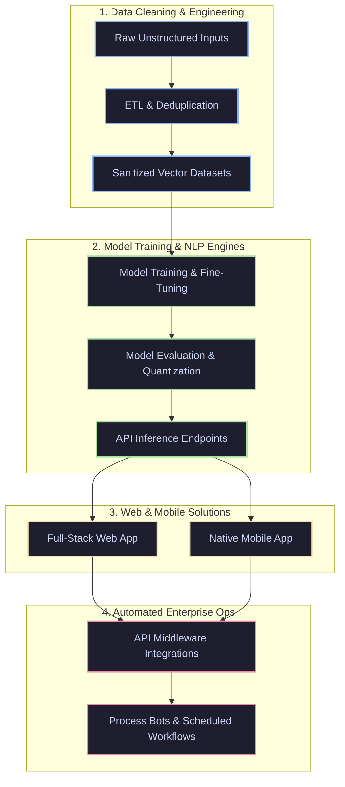
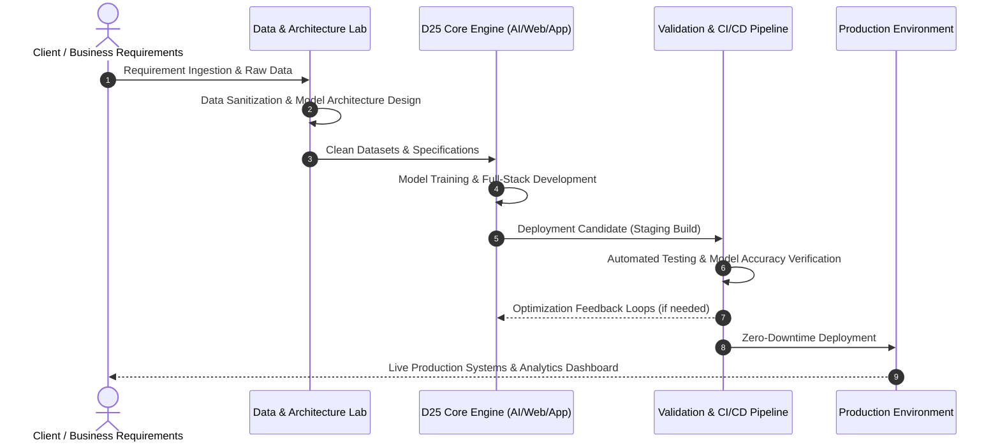

<div align="center">

# ⚡ D25 TECHNOLOGIES

### *Driven by Innovation. Built for the Future.*

[](https://d25.dhiraj.live)
[](mailto:d25softwares@gmail.com)
[](https://github.com/d25-Software)

---

```
  ____ ___  ____  
 |  _ \___ \|  _ \ 
 | | | |__) | |_) |
 | |_| / __/|  __/ 
 |____/_____|_|    
 DIGITAL DEVELOPMENT & AI SYSTEMS
```

</div>

---

## 📐 Ecosystem Architecture Flow

The D25 execution engine bridges raw data, custom machine learning pipelines, scalable backend microservices, and high-performance client applications.



---

## 🛠️ Core Technical Pillars

| Domain | Engineering Focus | Primary Stack |
| :--- | :--- | :--- |
| **🌐 Web Engineering** | Micro-frontends, Server-Side Rendering (SSR), Real-time WebSockets, Jamstack | `Next.js` `React` `TypeScript` `TailwindCSS` |
| **📱 Mobile Solutions** | Cross-platform architecture, Offline-first synchronization, Native bridges | `React Native` `Flutter` `Android/iOS` |
| **🤖 AI & Machine Learning** | Custom LLM fine-tuning, Computer Vision, RAG architectures, Model Quantization | `PyTorch` `TensorFlow` `Hugging Face` `OpenCV` |
| **🧹 Data Pipelines** | Large-scale ETL, Automated Data Sanitization, Data Validation, Vector DB Storage | `Pandas` `NumPy` `Apache Airflow` `Pinecone` |
| **⚡ Workflow Automation** | Headless browser automation, API Aggregation, Distributed Cron Systems | `Python` `Playwright` `Selenium` `FastAPI` |

---

## 🔄 Delivery Lifecycle Workflow

Every D25 engagement follows a rigorous, feedback-driven development cycle engineered for rapid iteration and zero-downtime deployment:



---

## ⚡ Tech Stack & Tools Matrix

### Frontend & Mobile


### Backend & Cloud Infrastructure


### AI, ML & Data Pipelines


---

## 📈 Performance & Quality Benchmarks

```
   Quality Metric              Target Standard            Status
   --------------------------------------------------------------
   Data Sanitization Accuracy   > 99.4% Integrity          [ PASSED ]
   Web Lighthouse Score         > 95+ (Perf/SEO/Access)    [ PASSED ]
   AI Inference Response Time   < 120ms (Quantized)        [ PASSED ]
   Code Test Coverage           > 90% Unit & E2E           [ PASSED ]
```

---

## 🤝 Connect & Collaborate

Whether you need a custom AI deployment, robust data cleansing, full-stack application development, or process automation, **D25** is built to deliver.

- 🌐 **Web Portal:** [d25.dhiraj.live](https://d25.dhiraj.live)
- 📧 **Direct Contact:** [d25softwares@gmail.com](mailto:d25softwares@gmail.com)
- 🐙 **GitHub Org:** [github.com/d25-Software](https://github.com/d25-Software)

---

<div align="center">

<sub>Copyright © D25 Technologies. Engineered for modern web & AI workloads.</sub>

</div>
